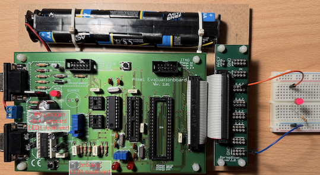
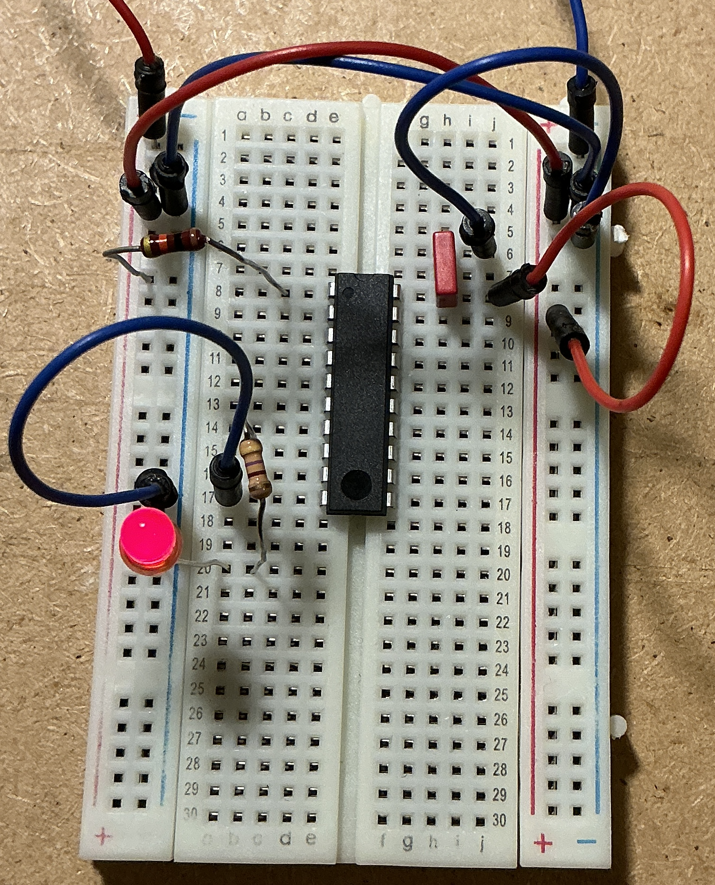

# ATtiny2313: LED blinken mit PlatformIO

Ein kleines AVR-C-Projekt ohne Arduino-Framework oder Bootloader. LED1
leuchtet 500 ms und ist danach 500 ms aus (bei 1 MHz CPU-Takt).


## Hardware vorbereiten

1. Stromversorgung trennen. Nur den ATtiny2313 in den 20-poligen Sockel
   IC3 einsetzen; Kerbe und Pin 1 nach Platinenaufdruck ausrichten.
   Die anderen Mikrocontroller-Sockel bleiben leer, da ihre Signale verbunden sind.
2. **JP6 stecken**: verbindet LED1 mit PD5, physischer Pin 9.
   LED und Vorwiderstand sind bereits auf dem Board vorhanden.
3. DIAMEX mit dem **ISP-Anschluss J1** verbinden, Pin 1 auf beiden Seiten
   beachten. J2 ist JTAG. Bei einem 6-auf-10-poligen Adapter muss dessen
   Belegung dem AVR-ISP-Standard entsprechen.
4. Das Board ueber seinen Versorgungseingang J5 versorgen
   (laut Board-Handbuch 9 V~). Die Target-Stromversorgung des DIAMEX dabei
   abschalten; die vorhandenen 5 V am ISP-Stecker sind dann die Zielspannung.
   Nicht gleichzeitig vom Programmer und vom Board-Netzteil speisen.
5. DIAMEX auf AVR-ISP-Betrieb einstellen. Die genaue Schalterstellung ist
   von der PROG-S-Version abhaengig und muss zur jeweiligen Anleitung passen.

Quelle fuer LED, Jumper, Sockel und Versorgung: `docs/Atmel_Evaluationboard_Ver201_D810074B.PDF`,
Schaltplan Seite 6, Beschreibung Seite 7, Jumpertabelle Seite 8.
`docs/prog-s_installation_de.pdf` beschreibt nur die Windows-Treiberinstallation;
die darin gezeigte INF-Datei ist fuer macOS nicht geeignet.

## In VS Code

Auf diesem Apple-Silicon-Mac ist die von PlatformIO geladene AVR-Toolchain
ein Intel-x86_64-Programm. Beim ersten Build trat deshalb
`Bad CPU type in executable` auf. Dafuer zuerst Apples Rosetta installieren,
zum Beispiel im macOS-Terminal:

```sh
softwareupdate --install-rosetta
```

Die angezeigten Lizenzbedingungen selbst pruefen und bestaetigen.
Danach den Build erneut ausfuehren.

1. Diesen gesamten Ordner ueber **Datei > Ordner oeffnen** oeffnen.
2. Die installierte Erweiterung **PlatformIO IDE** initialisieren lassen.
   Beim ersten Start werden PlatformIO Core und spaeter AVR-Werkzeuge geladen.
3. Im PlatformIO-Terminal `pio device list` ausfuehren. Nach Anschluss des
   PROG-S sollte ein zusaetzlicher Port wie `/dev/cu.usbmodem...` erscheinen.
   Diesen bei `upload_port` in `platformio.ini` eintragen, falls das Muster
   nicht passt oder mehrere Geraete angeschlossen sind.
4. **PlatformIO: Build** (Haken) ausfuehren.
5. Bei angeschlossener und versorgter Hardware **PlatformIO: Upload** (Pfeil)
   ausfuehren. Dabei wird das bisherige Programm ersetzt; je nach EESAVE-Fuse
   kann auch EEPROM geloescht werden. Die Fuses werden nicht geschrieben.

Alternativ im PlatformIO-Terminal:

```sh
pio run
pio device list
pio run -t upload
```

## Programmer und Takt

Der **DIAMEX PROG-S** spricht STK500v2 ueber einen virtuellen seriellen Port.
Ein echter AVRISP mkII verwendet eine andere USB-Anbindung. Daher nutzt dieses
Projekt `stk500v2` mit `/dev/cu.usbmodem...` und nicht `avrispmkii` mit `usb`.
Der ISP-Takt ist mit `-B 100` langsam eingestellt (nominell 10 kHz).
Mit `-B 10` scheiterte die Initialisierung; mit `-B 100` antwortet der ATtiny.

Die Konfiguration nimmt einen ATtiny2313 mit Werkseinstellungen an:
interner 8-MHz-RC-Oszillator und eingeschalteter Teiler CKDIV8, effektiv 1 MHz.
Der bestueckte 8-MHz-Quarz wird durch seine blosse Anwesenheit nicht aktiviert.
`board_build.f_cpu` informiert nur den Compiler und aendert den Hardwaretakt nicht.
Bei bereits umgestellten Fuses muss der Wert dem tatsaechlichen Takt entsprechen,
sonst stimmt die Blinkdauer nicht. Zunaechst keine Fuses oder Bootloader schreiben.

## Fehlersuche

- **Kein USB-Port:** Datenkabel, USB-Anschluss und AVR-Modus des Programmers
  pruefen. `pio device list` vor und nach dem Einstecken vergleichen.
- **Timeout:** richtigen Port, Programmer-Modus und Stromversorgung pruefen;
  einen eventuell offenen seriellen Monitor schliessen.
- **Device signature / initialization failed:** IC-Ausrichtung, Versorgung,
  ISP-Pin-1 und Adapterbelegung pruefen. Signaturpruefung nicht mit `-F` umgehen.
- **Upload erfolgreich, LED dunkel:** JP6 und LED1 pruefen.
- **Blinkt mit falscher Geschwindigkeit:** CPU-Takt und Fuse-Einstellungen
  ermitteln und anschliessend `board_build.f_cpu` anpassen.

Offizielle Referenzen:
- https://docs.platformio.org/en/latest/boards/atmelavr/attiny2313.html
- https://docs.platformio.org/en/latest/platforms/atmelavr.html#upload-using-programmer
- https://www.diamex.de/dxshop/USB-ISP-Programmer-fuer-AVR-STM32-LPC-ESP32-8266-Prog-S

## Bisherige Pruefung

Nach Installation von Rosetta kompiliert das Projekt erfolgreich:
102 Byte Flash, 0 Byte statisch belegtes RAM. PlatformIO Core 6.2.0,
Atmel AVR 5.3.0, AVR-GCC 7.3.0.
Der Programmer wurde inzwischen als `/dev/cu.usbmodem31201` erkannt;
dieser Port ist in `platformio.ini` eingetragen. Die Chip-Signatur ist
`1E 91 0A` (ATtiny2313/2313A). Ausgelesene Fuses: Low `0x64`, High `0xDF`;
das passt zur konfigurierten CPU-Frequenz von 1 MHz.
Das Blinkprogramm wurde erfolgreich ueber PlatformIO hochgeladen;
AVRDUDE hat alle 102 Byte Flash zurueckgelesen und verifiziert.
Die sichtbare LED-Funktion muss am Board kontrolliert werden (JP6 gesteckt).

## Port Expander

Über den Portexpander kann direkt auf die Atmel Prozessor Ports PA0-7, PB0-7, PC0-7, PD0-7 zugegriffen werden.

Die dürfen dann nicht durch die JP1-12 blockiert werden, das J1-12 die auf die on-board Komponenten lenkt.

Im Beispiel wird JP6 gezogen, damit der PD5 freigegeben.
An diesem PD5 hängt jetzt extern ein Vorwiderstand 470 Ohm und eine LED, die munter blinkt.



## Eigenständiger Aufbau auf dem Steckbrett

Der Test auf dem Evaluationboard war erfolgreich. Für den Betrieb mit geregelten
5 V auf einem halben Steckbrett ist mit den ausgelesenen Fuses kein Quarz nötig.
Die Firmware kann unverändert bleiben.

[Bauteilliste, Aufbauanleitung und optionale ISP-Belegung](hardware/README.md)

- [Schaltplan (SVG)](hardware/schaltplan.svg)
- [Verdrahtungsplan für ein halbes Steckbrett (SVG)](hardware/steckbrett.svg)
- [KiCad-Schaltplan (Legacy-Format)](hardware/blink.sch)

Auch der Aufbau auf einem Steckbrett klappt und es blinkt (siehe [hardware/README](hardware/README.md))


