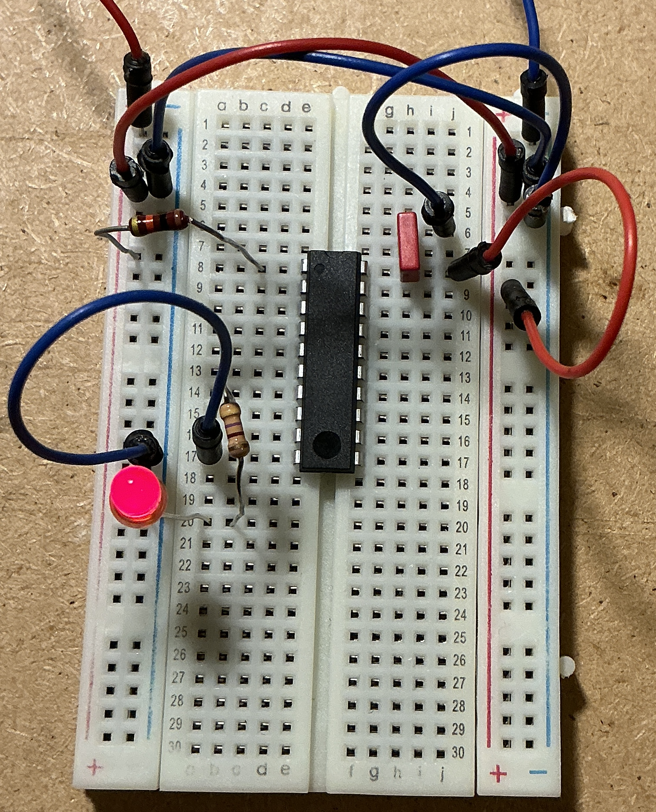

# ATtiny2313 auf einem halben Steckbrett

Für den vorhandenen **ATtiny2313 im DIP-20-Gehäuse** mit ausgelesenen Fuses
Low `0x64`, High `0xDF`. Der interne 8-MHz-RC-Oszillator mit Teiler 8 liefert
1 MHz. Kein Quarz und keine Quarzkondensatoren nötig; Pins 4 und 5 bleiben frei.
Die Firmware bleibt unverändert: PD5 / Pin 9 ist 500 ms HIGH, dann 500 ms LOW.
Das bereits programmierte IC startet beim Einschalten ohne Programmer.

## Dateien

- [Schaltplan](schaltplan.svg): direkt im Browser öffnen oder drucken.
- [Steckbrettplan](steckbrett.svg): 30 Reihen, Draufsicht mit Lochkoordinaten.
- [KiCad-Schaltplan](blink.sch): Legacy-Format mit lokaler Symbolbibliothek
  `blink-cache.lib` und `sym-lib-table`. Alle drei Dateien zusammen behalten.
  In KiCad öffnen/importieren und bei Bedarf als `.kicad_sch` speichern.
  KiCad ist auf diesem Rechner nicht installiert; Import und ERC wurden daher
  nicht in KiCad geprüft. Die SVG-Dateien sind die unmittelbar lesbare Referenz.

## Bauteile

| Anzahl | Bauteil | Bemerkung |
|---|---|---|
| 1 | Bereits programmierter ATtiny2313, DIP-20 | Aus dem Evaluationboard |
| 1 | Halbes Steckbrett, 30 Reihen / ca. 400 Kontakte | Durchgehende oder überbrückte Stromschienen |
| 1 | Rote LED | Standard-LED, z. B. 3 oder 5 mm |
| 1 | 470 Ω, 0,25 W | LED-Vorwiderstand; ca. 6 mA bei 2 V LED-Spannung |
| 1 | 100 nF Keramikkondensator | Abblockung; möglichst kurze Anschlüsse |
| 1 | 10 kΩ, 0,25 W | Empfohlener externer Reset-Pull-up |
| einige | Isolierte Steckbrücken | Versorgung und Signale |
| optional | 10 µF Elko, mindestens 10 V | Puffer am Versorgungseingang; Plus an +5 V |

Eine **geregelte 5-V-Gleichspannungsversorgung** wird vorausgesetzt.
Der ATtiny hat bereits einen internen Reset-Pull-up; R1 verbessert die
Störfestigkeit des Aufbaus. Der 100-nF-Kondensator gehört zur Grundbeschaltung.

## Aufbau mit konkreten Lochpositionen

Versorgung zuerst ausschalten. Das IC überspannt den Mittelkanal zwischen e/f.
Kerbe nach oben: Pin 1 = e8, Pin 10 = e17, Pin 11 = f17, Pin 20 = f8.
Die Pins 1–10 laufen links von oben nach unten, 11–20 rechts nach oben.

| Verbindung / Bauteil | Lochpositionen |
|---|---|
| Versorgung | +5 V an rote Schiene, 0 V an blaue Schiene |
| VCC, Pin 20 | j8 → rote Schiene |
| GND, Pin 10 | a17 → blaue Schiene |
| Reset-Pull-up R1, 10 kΩ | c4 ↔ c8 (Pin 1 / RESET) |
| Versorgung von R1 | rote Schiene → j4; g4 → a4 (isolierte Brücke außen führen) |
| C1, 100 nF | h8 ↔ h6; j6 → blaue Schiene |
| LED-Vorwiderstand R2, 470 Ω | b16 (Pin 9 / PD5) ↔ b20 |
| LED | Anode (langes Bein) d20, Kathode (kurzes Bein / flache Seite) d22 |
| LED-Masse | a22 → blaue Schiene |

Auf jeder Reihe sind **a–e** miteinander und **f–j** miteinander verbunden.
Über den Mittelkanal besteht keine Verbindung. Die Stromschienen sind davon
getrennt. Bei unterbrochenen Stromschienen beide Plus-Abschnitte sowie beide
Minus-Abschnitte überbrücken. Nicht Plus und Minus verbinden. Der Plan benutzt
nur das rechte Schienenpaar; linke Schienen werden nicht benötigt.

C1 möglichst nahe an die Versorgungspins setzen, mit kurzen Leitungen zur
Masse. Bei langen Zuleitungen den optionalen 10-µF-Elko ergänzen.
Die große Führung einzelner Drähte in der Zeichnung dient der Lesbarkeit;
in echt die Leitungen kurz halten. Kreuzungen isolierter Drähte sind keine
zusätzlichen elektrischen Kontakte.

Vor dem Einsetzen des IC die 5 V samt Polarität am späteren Pin 20 gegen Pin 10
messen. Versorgung ausschalten, IC einsetzen und dann einschalten. Bei passender
LED-Polung blinkt die LED sofort mit etwa einer Sekunde Periodendauer.
Unbenutzte I/O-Pins bleiben für dieses Beispiel unbeschaltet.

## Optional: direkt auf dem Steckbrett programmieren

Der Programmer wird zum bloßen Blinken nicht gebraucht. Für späteres ISP:

| AVR-ISP 6-polig, Signal | ATtiny DIP-Pin | Freies Steckbrettloch |
|---|---|---|
| 1 MISO | 18 / PB6 | j10 |
| 2 VCC / Zielspannung | 20 | i8 |
| 3 SCK | 19 / PB7 | j9 |
| 4 MOSI | 17 / PB5 | j11 |
| 5 RESET | 1 | d8 |
| 6 GND | 10 | d17 |

Die Nummern beziehen sich auf den standardisierten **6-poligen AVR-ISP**,
nicht unmittelbar auf einen 10-poligen Anschluss. Beim DIAMEX/Adapter dessen
Steckerbelegung und Pin-1-Markierung beachten. Bei externer 5-V-Versorgung
**Target-Speisung am Programmer abschalten**; gemeinsame Masse und
Zielspannungsanschluss trotzdem verbinden. Keine zwei Versorgungen parallel.
Die vorhandene langsame ISP-Einstellung und die Fuses unverändert lassen.

## Referenz

[Microchip: ATtiny2313A/4313-Datenblatt](https://ww1.microchip.com/downloads/en/DeviceDoc/doc8246.pdf),
DIP/SOIC-Pinbelegung und Abschnitte zu System Clock, Reset und Serial Programming.
Die hier verwendete DIP-20-Belegung gilt ebenfalls für den ATtiny2313.
Die Fuses und die Firmware-Pinwahl stammen aus `../platformio.ini` und `../src/main.c`.
